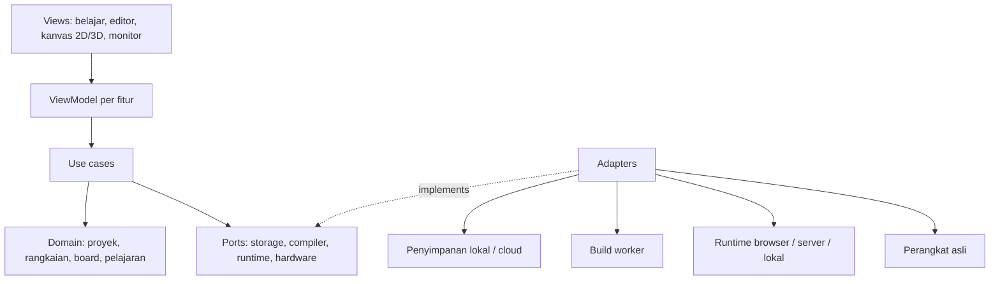

# Trinika Labs — Rancangan Arsitektur Platform IoT 2D/3D

Tanggal: 15 Oktober 2026  
Versi dokumen: 0.3  
Status: acuan awal pengembangan; kontrak teknis perlu dibuktikan melalui prototipe.  
Fondasi aplikasi: Next.js 16.4.1, React 19.3.0, TypeScript. Dokumen ini membedakan rancangan platform dari implementasi awal yang dicatat pada bagian 19.

## 1. Tujuan dan cakupan

Trinika Labs adalah platform open source untuk belajar, merangkai, memprogram, mensimulasikan, dan menjalankan proyek IoT pada perangkat asli. Sasaran jangka panjangnya adalah cakupan luas lintas keluarga board, komponen, bahasa, dan protokol, dengan pengalaman yang mudah dipahami pemula serta dapat diperluas komunitas.

Pengalaman utama: **pilih pelajaran → buka rangkaian → pahami sambungan → edit kode → jalankan → amati hasil → coba pada hardware asli**.

Platform harus dirancang untuk multi-board sejak awal. Rilis bertahap membuktikan arsitektur dan menambah cakupan; cakupan awal bukan batas permanen produk. Klaim dukungan selalu mengikuti hasil pengujian dan matriks kemampuan.

| Area | Sasaran cakupan |
| --- | --- |
| Hardware | Keluarga AVR, ESP, RP, STM32, dan keluarga lain melalui adapter |
| Komponen | Komponen pasif, sensor, aktuator, display, modul komunikasi, breadboard |
| Pemrograman | Framework/bahasa per board; Arduino C/C++, ESP-IDF, MicroPython, dan lainnya sebagai kandidat |
| Visual | Wiring 2D, skematik, laboratorium 3D, representasi perangkat dan lingkungan |
| Simulasi | Firmware, digital, peripheral, analog, lingkungan, jaringan sesuai engine |
| Perangkat asli | Build, upload, serial, debug sesuai board dan koneksi |
| Pembelajaran | Materi bertahap, contoh, tantangan, evaluasi, dan penjelasan kesalahan |
| Distribusi | Penggunaan lokal, self-host, layanan publik opsional, ekspor proyek terbuka |

Board Linux/SBC membutuhkan profil runtime berbeda dari mikrokontroler. Dukungan masa depan untuk SBC tidak berarti seluruh sistem operasi akan diemulasikan di browser.

## 2. Keputusan arsitektur yang menjadi acuan

1. **MVVM per fitur untuk aplikasi**, dengan domain dan use case yang independen dari UI.
2. **Satu dokumen proyek dan satu topologi rangkaian** untuk 2D, skematik, dan 3D.
3. **Renderer terpisah dari simulator**. Frame rate, kamera, dan mesh tidak menentukan hasil listrik.
4. **Beberapa runtime melalui kontrak adapter**; tidak mengasumsikan satu emulator dapat menjalankan semua chip.
5. **Board, komponen, compiler, dan runtime memiliki kontrak ekstensi berbeda**.
6. **Penyimpanan lokal lebih dahulu**, dengan format berversi dan sinkronisasi cloud opsional.
7. **Kode pengguna dieksekusi dalam lingkungan terbatas**, dengan batas sumber daya dan mekanisme penghentian.
8. **Dukungan dinyatakan per kemampuan dan versi**, bukan hanya label “board didukung”.
9. **Kebenaran simulasi diuji tanpa renderer**, termasuk pada mode headless.
10. **Infrastruktur tetap sederhana pada awalnya**: aplikasi modular dan worker eksekusi terpisah; layanan tambahan mengikuti kebutuhan yang terbukti.

Perubahan keputusan tersebut harus menjelaskan masalah, alternatif, dampak pada kontrak/data, strategi migrasi, dan pengujian. Untuk tahap awal, catat perubahan dalam bagian riwayat dokumen ini.

## 3. Arsitektur sistem



Panah menunjukkan dependensi kode. Aliran hasil memakai event/snapshot melalui port dan ViewModel; View tidak memanggil compiler atau emulator langsung.

### 3.1 Batas MVVM

| Lapisan | Tanggung jawab | Larangan |
| --- | --- | --- |
| View | Render, input pengguna, aksesibilitas | Menentukan aturan listrik atau menjalankan toolchain langsung |
| ViewModel | State tampilan, command, status proses, pemetaan diagnostik | Menjadi tempat emulator, solver, atau seluruh aturan domain |
| Application/use cases | Validasi, build, run, save, upload, evaluasi pelajaran | Bergantung pada React, Three.js, atau implementasi penyimpanan |
| Domain/model | Identitas, topologi, aturan, kemampuan, format data | Mengimpor Next.js, DOM, GPU, atau API browser |
| Adapter/infrastructure | Implementasi port dan integrasi teknologi | Membocorkan objek SDK vendor ke domain |

ViewModel boleh berupa controller TypeScript yang dibungkus hook React. Hook bukan syarat bagi domain. Jangan membuat satu ViewModel global yang mengelola seluruh produk.

### 3.2 Integrasi dengan Next.js

- Routing, halaman materi, metadata, dan pengambilan data awal memakai kemampuan server sesuai kebutuhan.
- Workspace interaktif memiliki entry point Client Component; editor, browser storage, koneksi perangkat, dan renderer diinisialisasi pada boundary client yang tepat.
- Domain dan protokol tetap dapat dijalankan di luar Next.js.
- API aplikasi menangani validasi permintaan dan pengiriman job. Build berat dan runtime panjang berjalan pada worker terpisah, bukan di request handler.
- Pemilihan adapter dilakukan pada composition root; domain menerima dependensi melalui port.
- Sebelum implementasi Next.js, baca panduan terkait di `node_modules/next/dist/docs/` sesuai AGENTS.md. Versi paket dipin dan kompatibilitas dependensi diperiksa saat pemasangan.

## 4. Model data dan pemisahan state

Pisahkan tiga state berikut:

| State | Isi | Masa hidup |
| --- | --- | --- |
| Dokumen proyek | Source files, board, komponen, koneksi, properti, layout, environment | Disimpan, berversi, dapat diekspor dan di-undo |
| State UI | Seleksi, panel, kamera, zoom, tool aktif | Umumnya lokal; tidak memengaruhi simulasi |
| State runtime | Waktu virtual, nilai pin, serial, status peripheral, telemetry | Per sesi; rekaman/checkpoint opsional terpisah |

Objek inti:

- `ProjectDocument`: identitas, versi schema, revisi, files, targets, circuit, presentation, environment, dependencies.
- `Target`: board instance, framework, entry point, profil build dan runtime.
- `CircuitGraph`: instance komponen, terminal, wire, junction, dan net hasil derivasi.
- `BoardDefinition` / `ComponentDefinition`: definisi berversi yang digunakan instance.
- `PresentationDocument`: posisi 2D, transform 3D, rute visual kabel, dan layout skematik.
- `BuildArtifact`: firmware beserta manifest boot/partition bila diperlukan, hash input, profil toolchain, diagnostik.
- `SimulationSession`: session ID, snapshot/revisi proyek, runtime, kemampuan, seed, status, clock.
- `LessonDefinition`: materi, proyek awal, tujuan, langkah, hint, dan assertion hasil.

Gunakan ID terminal stabil, misalnya `board-a:gpio-2`, bukan index mesh, nama label, atau posisi pin di layar. Label tampilan boleh berubah tanpa mengubah sambungan.

### 4.1 Aturan topologi

- Koneksi listrik berasal dari terminal/wire/junction yang eksplisit.
- Persilangan kabel visual tidak otomatis menjadi sambungan.
- Kontak breadboard mengikuti definisi konektivitas internal berversi, bukan bentuk atau jarak mesh.
- Pemasangan komponen ke lubang breadboard menjadi command domain dengan validasi; pergerakan bebas tidak menciptakan kontak listrik diam-diam.
- Net adalah hasil perhitungan dari graph dan konektivitas internal; cache net harus dapat dibangun ulang.
- Validasi mempertimbangkan model tegangan, polaritas, pin capability, pull-up, dan batas yang tersedia. Aturan yang belum dimodelkan tidak boleh dilaporkan sebagai sudah tervalidasi.
- Project dapat memiliki beberapa target/board. Eksekusi bersama beberapa board memerlukan dukungan scheduler/runtime yang khusus diuji.

## 5. Konsep workspace 2D dan 3D

### 5.1 Peran setiap tampilan

| Tampilan | Kegunaan |
| --- | --- |
| Wiring 2D | Cepat merangkai, melihat label pin, dan mengikuti tutorial |
| Skematik | Memahami struktur listrik dan aliran sinyal |
| Laboratorium 3D | Memahami posisi fisik, orientasi, pemasangan, dan perilaku perangkat |
| Lingkungan 3D | Eksperimen seperti lampu ruangan, penyiraman tanaman, atau robot sederhana |

Semua tampilan berbagi ID komponen dan topologi yang sama. Layout masing-masing dapat berbeda. Pergantian tampilan mempertahankan kode, sambungan, selection, serta sesi simulasi yang aktif.

Renderer mendapatkan projection model yang ringan dari dokumen dan snapshot runtime. LED menyala karena sinyal hasil simulasi; memutar kamera tidak boleh mengubah sinyal. Kedipan cahaya dan animasi motor merupakan visualisasi state, kecuali sebuah model fisika memang digunakan sebagai sumber perilaku.

### 5.2 Interaksi 3D

- Orbit, pan, zoom, tampilan atas, dan reset kamera.
- Pilih objek, fokus komponen, inspect pin, highlight sambungan.
- Snap ke grid/lubang dengan preview; commit pemasangan hanya melalui command yang tervalidasi.
- Tambah kabel dengan memilih terminal, tampilkan rute serta endpoint sebelum commit.
- Tekan tombol, putar knob, atau ubah sensor sebagai event input runtime yang tercatat.
- Tampilkan nilai pin dan diagnostik melalui overlay/panel HTML.
- Sediakan mode kualitas rendah, fallback 2D, serta operasi melalui daftar komponen/pin dan keyboard.

3D tidak boleh menjadi prasyarat untuk menyelesaikan pelajaran dasar. Saat GPU tidak tersedia, proyek tetap dapat dibuka, diedit, dan dipahami melalui 2D serta panel tekstual.

### 5.3 Kontrak aset dan koordinat

- Kandidat renderer: Three.js dengan React Three Fiber, dibungkus adapter renderer. Pasangkan versi Fiber dengan major React yang kompatibel; dokumentasi saat penyusunan menyebut Fiber 9 untuk React 19. Jangan menjadikan versi alpha sebagai kebutuhan dasar.
- Format distribusi aset: glTF 2.0/GLB. File sumber model dapat disertakan untuk kemudahan kontribusi.
- Konvensi internal scene: satu unit = satu meter, right-handed, +Y ke atas; ukuran board dicatat eksplisit dan diverifikasi.
- Setiap aset memiliki origin, orientasi, bounding box, terminal anchors, serta pemetaan ke ID terminal domain.
- Pin anchors didefinisikan dalam koordinat lokal komponen dan ditransformasikan oleh renderer.
- Scene menyimpan referensi aset dan transform; jangan menyimpan objek Three.js atau seluruh mesh ke JSON proyek.
- Setiap aset membawa versi, checksum, lisensi, atribusi, dan sumber. Aset tidak boleh menyisipkan kode eksekusi.
- Loader membatasi ukuran dan memvalidasi aset; referensi remote tidak diunduh otomatis tanpa kebijakan yang jelas.
- Gunakan lazy loading, mesh sederhana, instancing untuk objek berulang, serta pelepasan resource GPU saat tidak dipakai.

### 5.4 Lingkungan dan digital twin

Pisahkan tiga tingkat kemampuan:

1. **Visualisasi**: animasi LED/display/motor berdasarkan telemetry.
2. **Model edukasi**: suhu, cahaya, kelembapan, dan perilaku mekanis memakai parameter serta rumus yang didokumentasikan.
3. **Model fisika tervalidasi**: solver dengan parameter, toleransi, dan batas penerapan yang diuji.

Setiap skenario menyebut tingkat fidelitasnya. Tampilan realistis tidak menjamin hasil fisika realistis. Digital twin perangkat asli di tahap berikutnya menampilkan telemetry bertimestamp dengan indikator latensi, kehilangan koneksi, dan data kedaluwarsa.

## 6. Ekstensi hardware dan registry

Pisahkan manifest dari implementasi:

| Ekstensi | Kontrak |
| --- | --- |
| Board | Chip/varian, pinout, domain tegangan, flash/memory, profil framework |
| Component | Terminal, parameter, model perilaku, visual 2D/3D |
| Compiler | Input source/dependency/profile → artifact dan diagnostik |
| Runtime | Load, start, pause bila tersedia, stop, input, snapshot, event |
| Hardware | Discover/connect, upload, serial/debug bila tersedia |
| Lesson | Materi, proyek, tujuan, assertion, bahasa, sumber |

Manifest memuat ID namespaced, versi, rentang SDK, dependency, lisensi, sumber, dan permission. Proyek mengunci versi serta hash ekstensi/toolchain yang dipakai.

Kemampuan discovery harus tersedia sebelum pengguna menekan Run. Contoh: GPIO teruji, ADC sebagian, I²C belum tersedia. Kemampuan efektif adalah irisan kemampuan board, runtime, compiler/framework, dan model komponen.

Gunakan status `planned`, `experimental`, `partial`, `verified`, `unsupported`, dengan catatan batas serta referensi pengujian. `Verified` berlaku pada kombinasi versi dan kemampuan tertentu, bukan klaim semua library/peripheral bekerja.

Tahap awal memuat ekstensi yang dikurasi saat build. Kode plugin pihak ketiga tidak dijalankan bebas di main thread. Marketplace dinamis baru dibangun setelah kontrak permission, isolasi, validasi, dan distribusi tersedia.

## 7. Simulasi dan kompilasi

### 7.1 Strategi engine

Setiap keluarga chip dapat memakai engine berbeda. Kandidat AVR adalah AVR8js; kandidat ESP adalah fork QEMU Espressif. Keduanya memerlukan pembuktian kemampuan sesuai versi. QEMU menyediakan emulasi CPU, memori, dan sejumlah peripheral ESP32; integrasi GPIO ke kanvas atau dukungan seluruh varian ESP tidak diasumsikan otomatis tersedia.

MicroPython atau framework lain membutuhkan firmware/runtime yang sesuai target. Dukungan sintaks editor saja bukan dukungan eksekusi. Kandidat engine untuk keluarga lainnya ditentukan melalui evaluasi lisensi, kompatibilitas firmware, peripheral, performa, distribusi, serta kemudahan self-host.

Mode simulasi dibedakan secara eksplisit:

- `firmware-emulation`: firmware dibangun dan dieksekusi oleh emulator target.
- `behavioral`: subset perilaku/API dimodelkan untuk edukasi; batas API dan timing dijelaskan.
- `hardware-connected`: hasil berasal dari perangkat asli.

Jangan menampilkan perilaku yang diparsing dari teks kode sebagai emulasi firmware penuh.

### 7.2 Clock dan pertukaran event

- Waktu simulasi dimiliki runtime/scheduler, terpisah dari waktu rendering dan wall clock.
- Gunakan timestamp integer dengan unit yang disepakati, sequence, session ID, dan protocol version.
- Definisikan nilai digital minimal low, high, high-impedance, dan unknown; jangan mereduksi semua sinyal menjadi boolean.
- Event pada waktu sama memiliki urutan deterministik. Randomness memakai seed yang dicatat.
- Runtime menyatakan kemampuan pause, step, reset, checkpoint, serta reproduksibilitas; kemampuan yang tidak tersedia disembunyikan/dijelaskan.
- Telemetry UI dibatch dan dibatasi; buffer serial memiliki batas. Sampling untuk tampilan tidak boleh membuang event yang dibutuhkan solver.
- Worker browser tidak boleh memblokir main thread. Server runtime mempunyai heartbeat, timeout, dan penghentian paksa.

Co-simulation digital/analog atau beberapa board bukan sekadar menggabungkan event. Ia memerlukan negosiasi langkah waktu, batas konvergensi, dan validasi konsistensi. Pada fase awal, satu session memakai satu konfigurasi engine yang terbukti; kombinasi engine lain ditolak dengan diagnostik, bukan dianggap berjalan.

### 7.3 Build dan lifecycle

Alur: snapshot dokumen → validasi → resolve dependency terkunci → build → verifikasi artifact → buat session → load → run → telemetry → stop/dispose.

- Status build terpisah dari status session. Session minimal: idle, preparing, ready, running, paused bila didukung, stopped, failed.
- Setiap request dapat dibatalkan dan mempunyai ID; hasil job lama tidak boleh mengganti hasil revisi baru.
- Jika kode/rangkaian berubah saat run, tandai session memakai revisi lama. Terapkan perubahan melalui restart, kecuali runtime mendukung perubahan langsung yang jelas.
- Cache build memakai hash source, dependency, target, flags, toolchain, dan konfigurasi relevan.
- Artifact menyertakan firmware, offset flash, bootloader/partition bila dibutuhkan; jangan mengasumsikan satu file binary cocok untuk semua board.
- Adapter upload memvalidasi target dan artifact sebelum menulis ke perangkat.

## 8. Penyimpanan dan format proyek

Penyimpanan awal menggunakan repository lokal melalui port, dengan IndexedDB sebagai kandidat implementasi browser. Cloud repository memakai kontrak yang sama tanpa membuat akun wajib untuk belajar.

Format ekspor: bundle berisi manifest JSON, source files, dependency lock, referensi/aset berlisensi bila diperbolehkan, dan metadata. Firmware/cache besar serta log runtime bukan bagian wajib dokumen.

Contoh struktur konseptual, belum merupakan schema final:

```text
ProjectDocument
  schemaVersion, id, revision, metadata
  files[]: path, content
  targets[]: id, boardInstanceId, framework, entryPoint, buildProfile
  circuit: instances[], wires[], junctions[]
  presentation: wiring2d, schematic, scene3d
  environment: modelReferences, parameters
  dependencies: definitions, runtimes, toolchains, libraries, assetHashes
```

Impor memvalidasi schema, ukuran, path, hash, serta versi; tidak mengeksekusi kode. Migrasi dilakukan dari salinan dengan backup dan diagnostik. Proyek dengan versi lebih baru yang tidak dipahami tidak ditimpa diam-diam.

Command dokumen menjadi dasar undo/redo; autosave atomik dengan debounce. Kamera tidak memenuhi history rangkaian. Sinkronisasi memakai revisi untuk mendeteksi konflik; jangan menimpa konflik secara diam-diam. Kolaborasi real-time diputuskan kemudian setelah format dan command stabil.

## 9. Pembelajaran, aksesibilitas, dan perangkat asli

- Pelajaran memiliki tujuan konkret, penjelasan sambungan, kode yang dapat diedit, tantangan, dan cara membaca hasil.
- Pemeriksaan memakai sinyal domain/runtime, bukan screenshot LED. Assertion mencatat toleransi waktu dan kemampuan engine yang dibutuhkan.
- Diagnostik menerangkan penyebab, lokasi file/pin/komponen, dan langkah perbaikan dalam bahasa sederhana.
- Materi dan UI mendukung lokalisasi; string UI tidak menjadi identitas domain.
- Warna kabel/sinyal selalu dilengkapi label atau simbol. Navigasi keyboard dan panel tekstual menjadi bagian acceptance criteria.
- Koneksi hardware memerlukan tindakan pengguna sesuai permission browser. Web Serial mempunyai dukungan browser terbatas; sediakan ekspor artifact/instruksi tool lokal, lalu local bridge bila diperlukan.
- Konfigurasi Wi-Fi, token MQTT, dan rahasia lain tidak diekspor atau dibagikan secara default. Contoh belajar menggunakan placeholder atau layanan mock.

## 10. Batas eksekusi dan self-host

Web Worker menjaga responsivitas, tetapi bukan batas keamanan yang cukup bagi kode plugin tidak tepercaya. Runtime browser membutuhkan isolation yang sesuai, API terbatas, dan watchdog; mekanismenya dibuktikan sebelum kode pihak ketiga dimuat.

Build/runtime server berjalan tanpa privilege dengan batas CPU, memori, waktu, output, filesystem, dan jaringan. Mount sumber per job; tidak memasang socket Docker host atau rahasia layanan. Toolchain yang disediakan dikurasi dan berversi; compiler flags tidak menjadi shell string bebas.

Mode jaringan belajar menggunakan jaringan virtual atau endpoint yang dibatasi. Akses internet nyata menjadi kemampuan eksplisit. Local bridge, jika dibuat, memakai autentikasi sesi/origin dan hanya membuka operasi yang diperlukan.

Self-host menyediakan profil web, build worker, dan runtime sesuai kebutuhan. Engine browser tidak harus bergantung pada cloud. Antarmuka port memungkinkan deployment sederhana terlebih dahulu; antrean/broker/database tambahan mengikuti beban yang terukur.

## 11. Struktur repositori dan aturan dependensi

Target struktur modular berikut tidak mengharuskan memindahkan starter Next.js sebelum kontrak inti terbukti. Awalnya domain/use case dapat ditempatkan di `src/`; ekstraksi package dilakukan ketika ada konsumen browser, worker, atau CLI yang membutuhkan.

```text
apps/
  web/                       # Next.js: routing dan composition root
packages/
  domain/                    # Model dan aturan tanpa dependency UI
  application/               # Use cases dan ports
  project-format/            # Schema, validator, migrasi
  extension-sdk/             # Kontrak ekstensi
  circuit-core/              # Topologi dan derivasi net
  simulation-protocol/       # Message, clock, capability
  renderer-2d/                # Projection dan interaksi 2D
  renderer-3d/                # Adapter Three.js/Fiber
  hardware-connect/          # Adapter koneksi perangkat
  ui/                        # Komponen tampilan bersama
extensions/
  boards/
  components/
  compilers/
  runtimes/
services/
  build-worker/
  runtime-worker/
content/
  lessons/
  examples/
assets/
  models/                    # Aset beserta manifest dan atribusi
docs/
  ARCHITECTURE.md
```

Dalam aplikasi, fitur seperti workspace, learning, projects, dan catalog memiliki `views/` serta `viewmodels/` masing-masing. Composition root merangkai implementasi; registry tidak mengimpor ViewModel.

Domain menjadi dependency dasar; application bergantung pada domain. Adapter bergantung pada kontrak application/SDK. Renderer bergantung pada projection data dan protokol, bukan implementasi compiler. Cegah circular dependency dan import lintas package ke folder internal melalui pemeriksaan otomatis saat package dipisahkan.

## 12. Pengujian dan kriteria kualitas

| Area | Bukti yang diperlukan |
| --- | --- |
| Domain | Topologi/net, breadboard, validasi pin, command undo/redo |
| Format | Round-trip ekspor/impor, migrasi, dependency hilang, input rusak |
| Adapter | Contract tests lifecycle, capability, cancellation, timeout |
| Firmware | Contoh referensi GPIO, serial, lalu peripheral per kombinasi versi |
| 2D/3D | ID dan topologi sama, selection sinkron, fallback, operasi keyboard |
| Runtime | Clock/order, batas buffer, seed, penghentian, revisi input konsisten |
| Pembelajaran | Assertion headless dan penjelasan diagnostik yang sesuai |
| Eksekusi | Batas sumber daya, isolasi filesystem/network, job gagal tidak mencemari job lain |

Benchmark awal menggunakan fixture terdokumentasi: dua board, 50 instance komponen, dan 100 wire pada perangkat/browser referensi. Target awal yang perlu diukur: interaksi utama di bawah 100 ms dan 3D setidaknya 30 FPS dalam mode rendah. Ini target acceptance, bukan hasil yang sudah terbukti; sesuaikan dengan pengukuran dan kebutuhan pengguna.

Batasi frekuensi render telemetry secara terpisah dari tick simulasi. Jangan membuat seluruh workspace rerender pada setiap perubahan pin. Build/simulation performance dilaporkan per engine, bukan satu angka universal.

## 13. Roadmap berdasarkan bukti

### Fase A — Kontrak dan pembuktian engine

- Tetapkan schema awal, terminal ID, capability, runtime protocol, serta command dokumen.
- Evaluasi minimal dua keluarga chip berbeda, misalnya AVR dan ESP, tanpa menetapkan kandidat sebagai dukungan terverifikasi sebelum diuji.
- Buktikan source → firmware → serial/GPIO → model LED/tombol.
- Buktikan satu proyek yang sama tampil 2D dan 3D tanpa perubahan topologi.
- Catat lisensi, kekurangan peripheral, kebutuhan server, dan biaya resource setiap engine.

Syarat selesai: demonstrasi yang dapat diulang, hasil contract tests, dan matriks kemampuan kedua keluarga. Jika integrasi suatu engine gagal, catat batas dan evaluasi adapter lain sebelum menjanjikan fitur.

### Fase B — Rilis belajar pertama

- Workspace, editor, wiring, mode 3D sederhana, serial, Run/Stop.
- Autosave, undo/redo, ekspor/impor, fallback 2D.
- Pelajaran dasar untuk keluarga board yang sudah terbukti.
- Katalog menampilkan kemampuan; unsupported configuration menghasilkan diagnostik.

Syarat selesai: pengguna baru menyelesaikan satu pelajaran tanpa akun, mengekspor proyek, dan membukanya kembali dengan hasil yang sama sesuai toleransi engine.

### Fase C — Ekosistem kontribusi

- SDK terdokumentasi, template ekstensi, validator manifest, contract tests.
- Tambah keluarga board dan peripheral berdasarkan kebutuhan pembelajaran.
- Panduan aset 3D, atribusi, contoh, serta review kontribusi.
- Upload/serial perangkat asli dengan jalur fallback.

Syarat selesai: kontributor dapat menambahkan satu komponen atau board profile tanpa mengubah domain/renderer inti.

### Fase D — IoT dan lingkungan

- MQTT/HTTP melalui model jaringan yang terkendali.
- Sensor lingkungan, dashboard, skenario kegagalan jaringan.
- Multi-board/co-simulation hanya pada kombinasi yang telah divalidasi.
- Solver analog/model mekanis diperkenalkan bersama batas fidelitasnya.

### Fase E — Skala dan kemampuan lanjutan

- Kolaborasi, classroom, distribusi ekstensi dinamis, telemetry perangkat nyata.
- Digital twin, debugging lebih luas, dan skenario lintas runtime.
- AR/VR hanya setelah workspace, aksesibilitas, dan kebutuhan belajar terbukti.

Tidak menetapkan tanggal rilis sebelum proof-of-concept engine. Lebar katalog bertambah paralel dengan kedalaman dukungan dan kualitas materi.

## 14. Open source dan tata kelola

- Pilih lisensi kode proyek sebelum rilis publik. Lisensi source, konten, aset, firmware, dan dependency dicatat terpisah; keputusan satu lisensi tidak otomatis melisensikan seluruh bundle.
- Semua adapter harus dapat dibangun dengan prosedur yang terdokumentasi. Integrasi proprietary dapat menjadi opsi, tetapi fungsi inti tidak bergantung wajib padanya.
- Sertakan panduan setup, self-host, kontribusi, dukungan versi, pelaporan masalah, dan review perubahan kontrak.
- Setiap kontribusi hardware mencantumkan varian, sumber pinout, lisensi aset, contoh, dan bukti pengujian kemampuan.
- Perubahan schema/protokol/SDK memakai versi dan migrasi; pertahankan fixture proyek lama untuk pengujian kompatibilitas.
- Prioritaskan issue kontribusi kecil: materi, pinout, model komponen, aset 3D, dan pengujian peripheral.

## 15. Hal yang harus dihindari

- Menjadikan gambar board atau mesh 3D sebagai sumber topologi listrik.
- Menggandakan rangkaian untuk 2D dan 3D.
- Menaruh compiler/emulator di ViewModel atau request handler Next.js.
- Menganggap Arduino framework sama dengan arsitektur chip.
- Menganggap seluruh keluarga ESP, AVR, atau STM32 mempunyai peripheral identik.
- Menyamakan visualisasi, model edukasi, dan simulasi fisika tervalidasi.
- Menyamakan dukungan editor bahasa dengan kemampuan menjalankan kode.
- Membuat animasi dari pola teks kode lalu menyebutnya emulasi firmware.
- Menyimpan state GPU/runtime ke dokumen proyek.
- Menjalankan ekstensi tidak tepercaya tanpa isolasi dan batas resource.
- Mengklaim dukungan penuh berdasarkan satu contoh Blink.
- Membangun banyak layanan atau marketplace sebelum kontrak inti stabil.

## 16. Keputusan terbuka sebelum implementasi terkait

| Keputusan | Cara menyelesaikannya |
| --- | --- |
| Engine tiap keluarga | Spike firmware/peripheral, evaluasi lisensi dan deployment |
| Versi Three.js/Fiber | Cocokkan React terpasang, pin versi, uji build dan browser |
| Editor dan state library | Uji ukuran bundle, aksesibilitas, language tooling; domain tetap independen |
| Solver analog | Evaluasi model, coupling, toleransi, distribusi dan lisensi |
| Local bridge | Buktikan kebutuhan browser/hardware yang tidak tercakup jalur lain |
| Lisensi proyek dan konten | Tetapkan kebijakan setelah inventaris dependency dan aset |
| Kolaborasi real-time | Putuskan setelah command, revisi, dan konflik dokumen stabil |

Keputusan terbuka tidak menghalangi penulisan domain/format awal, tetapi implementasi yang bergantung padanya harus menunggu pembuktian. Dokumen ini mengurangi risiko arah pengembangan; kelayakan engine dan fidelity tetap harus diuji.

## 17. Referensi teknis

Referensi diperiksa pada 15 Oktober 2026. Baca kembali versi dokumentasi yang sesuai dependency saat implementasi.

- Panduan Next.js lokal: `node_modules/next/dist/docs/01-app/03-api-reference/01-directives/use-client.md` dan panduan fitur terkait dalam paket terpasang.
- [React Three Fiber: introduction dan kompatibilitas React](https://r3f.docs.pmnd.rs/getting-started/introduction).
- [Three.js documentation](https://threejs.org/docs/).
- [Khronos glTF](https://www.khronos.org/gltf/).
- [AVR8js: emulator AVR browser/Node.js](https://github.com/wokwi/avr8js).
- [Espressif QEMU: kemampuan dan eksekusi firmware](https://docs.espressif.com/projects/esp-idf/en/latest/esp32/api-guides/tools/qemu.html).
- [Web Serial: kemampuan dan kompatibilitas browser](https://developer.mozilla.org/en-US/docs/Web/API/Web_Serial_API).

## 18. Riwayat keputusan

| Tanggal | Versi | Keputusan |
| --- | --- | --- |
| 15 Oktober 2026 | 0.1 | Multi-board, MVVM per fitur, satu graph 2D/3D, adapter runtime, fase berbasis bukti, dan format proyek terbuka sebagai fondasi |
| 15 Oktober 2026 | 0.2 | Registry definisi berversi dan boundary JSON schema 1 tersedia; resolusi toolchain dan runtime tetap terpisah dari validasi dokumen |
| 15 Oktober 2026 | 0.3 | Workspace MVVM 2D dengan katalog generik, history, file editor, simpan lokal manual, dan impor/ekspor JSON tersedia |

## 19. Status implementasi awal

Fondasi awal tersedia di `src/core/domain/`, `src/core/application/`, dan `src/core/project-format/`:

- Model dokumen schema versi 1 dengan target multi-board dan layout 2D/3D terpisah dari topologi.
- Identitas endpoint berbasis tuple instance/terminal agar tidak bertabrakan karena delimiter atau nama tampilan.
- Validasi struktural definisi, ID elemen, endpoint, dan koneksi internal komponen.
- Derivasi net deterministik dari wire, junction, dan koneksi internal, termasuk terminal yang tidak tersambung.
- Command `connectWire` mengembalikan dokumen baru dengan revisi bertambah hanya jika graph valid.
- Registry definisi dikunci berdasarkan ID namespaced dan versi tepat, dengan snapshot immutable dan status per kemampuan. Status `verified` wajib mencantumkan referensi bukti; pemeriksaan isi bukti tetap tanggung jawab review kontribusi.
- Parser JSON schema 1 merekonstruksi field yang diketahui dan memvalidasi struktur, graph, dependency lock, target board/entry point, serta layout. Field tidak dikenal atau versi lain ditolak agar tidak hilang saat penyimpanan ulang.
- Serializer menggunakan boundary pemeriksaan yang sama sebelum menghasilkan JSON proyek.
- Pengujian domain memakai fixture sintetis melalui `npm test`, tanpa browser atau dependensi UI.
- Workspace di `src/features/workspace/` menggunakan controller TypeScript yang dibungkus `useSyncExternalStore`. View mengirim command; controller memakai use case dan validator core.
- Katalog awal di `src/core/catalog/` menyediakan papan latihan generik, LED, resistor, tombol dua terminal, dan satu baris breadboard. Simbol tidak mengklaim dukungan firmware atau pinout board nyata.
- Kanvas SVG 2D menampilkan terminal, wire, dan junction; penempatan tidak menentukan konektivitas. Terminal anchors mengikuti rotasi komponen. Posisi junction impor saat ini diturunkan dari terminal tetangga dan belum dapat diedit secara visual.
- Edit mendukung drag, keyboard, koordinat X/Y, properti, penghapusan dengan pembersihan kabel/layout/target terkait, serta 50 snapshot undo/redo. Impor dapat di-undo.
- File editor berupa textarea; perubahan diterapkan pada blur. Compiler, autocomplete, dan language server belum tersedia.
- Penyimpanan manual memakai localStorage melalui port. Simpanan rusak tidak ditimpa pada inisialisasi. Ekspor JSON tetap dapat digunakan jika penyimpanan browser gagal. IndexedDB dan autosave menjadi pekerjaan berikutnya.

Boundary impor awal menerima maksimal satu juta UTF-16 code unit, 2.000 instance/wire/junction per array, 500 file, dan 100 target. Angka ini batas proteksi awal, bukan target kapasitas platform. Path file harus relatif dengan separator POSIX, tanpa traversal. Transform harus finite dan scale positif. Properti komponen hanya scalar pada schema awal; format kompleks membutuhkan perubahan schema.

Validasi impor memastikan referensi part tersedia di registry dan framework tercatat pada dependency lock. Ia belum membuktikan framework/library/toolchain terpasang, hash terverifikasi, atau sebuah proyek bisa dibangun/disimulasikan; itu tugas resolver dan adapter berikutnya. Format bundle/aset dan migrasi belum tersedia. Registry menerima definisi TypeScript yang dikurasi, bukan manifest plugin tidak tepercaya dari jaringan.

Belum tersedia: katalog board nyata, resolver dependency/toolchain, migrasi, validasi tegangan/arus, renderer 3D, compiler, runtime emulator, dan koneksi perangkat. History saat ini per sesi dan tidak disimpan lintas reload. Format environment serta bundle aset juga belum tersedia.

Jalankan `npm test`, `npm run typecheck`, `npm run lint`, dan `npm run build` untuk memeriksa implementasi. Build alternatif `--webpack` tersedia ketika sandbox memblokir port internal Turbopack. Pemeriksaan browser interaktif belum dilakukan pada sesi implementasi workspace karena izin server lokal ditolak.

Tahap berikutnya adalah projection 3D dari dokumen yang sama dan kontrak runtime untuk pembuktian engine sesuai Fase A. Workspace tetap menandai simulasi/upload yang belum tersedia; tersedianya editor 2D tidak berarti Fase A pembuktian emulator selesai.
